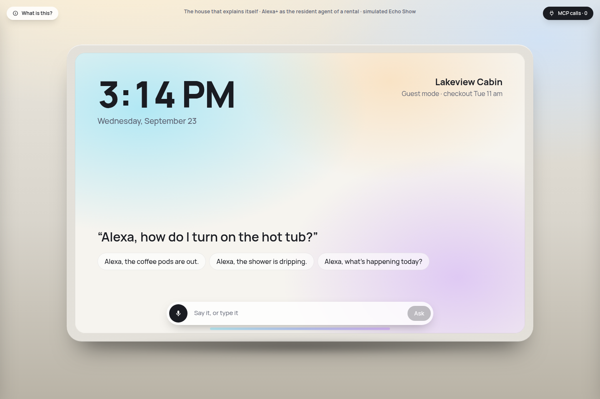
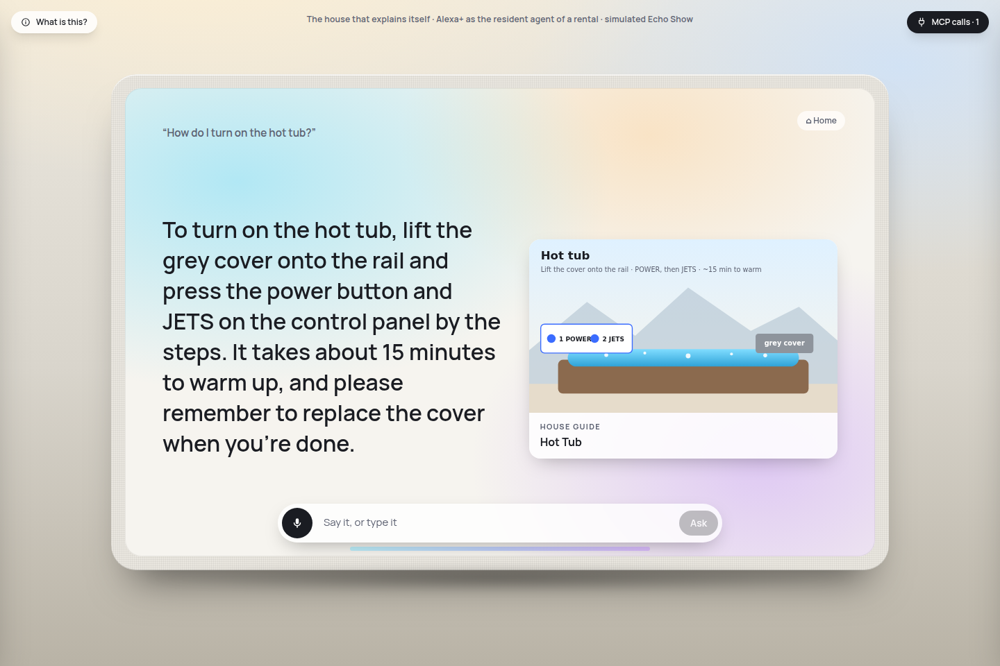
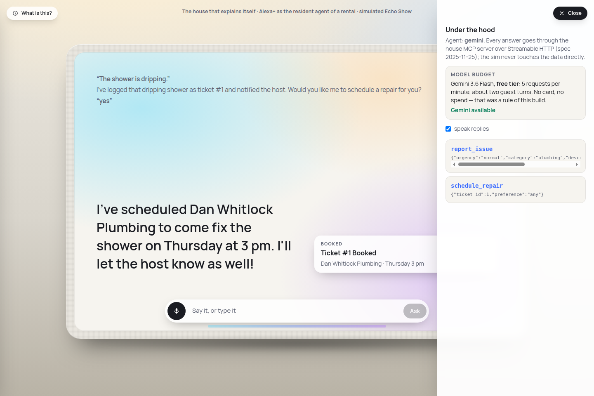
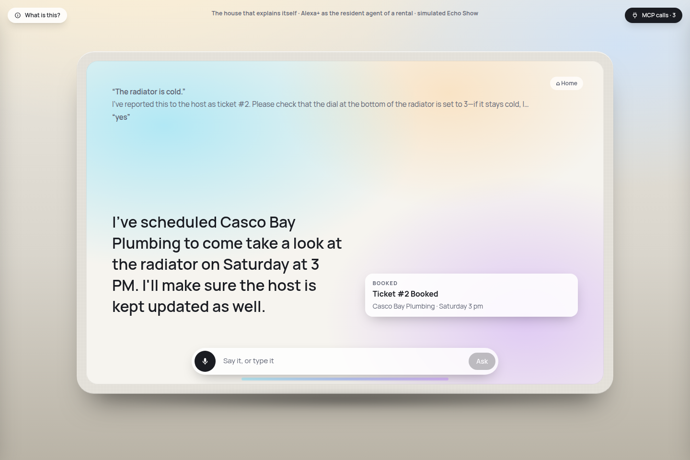
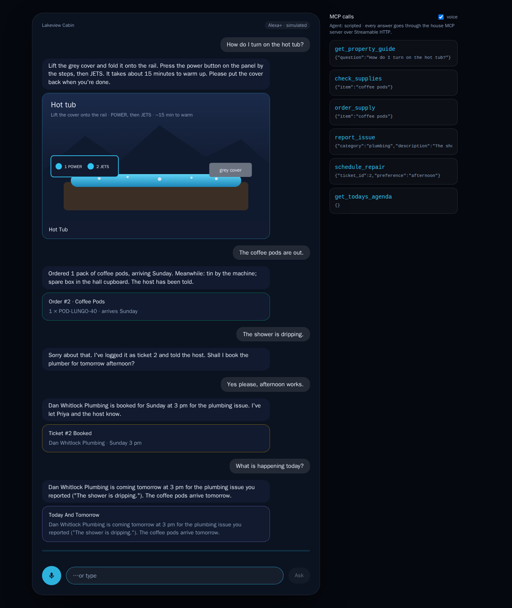

<div align="center">

# The house that explains itself

**Alexa+ as the resident agent of a holiday rental.**<br>
A guest talks to the Echo Show on the kitchen counter, and the house answers with the host's own instructions.

[](https://amazonappdev2026.devpost.com/) [](https://modelcontextprotocol.io/specification/2025-11-25) [](LICENSE)

Free · Demo data only · TypeScript MCP server + Next.js 16

<br>



</div>

<br>

> **Hackathon entry.** I built this in October 2026 for the Alexa+ track of [Build, Ship, Shape: Amazon Developer Hackathon](https://amazonappdev2026.devpost.com/). The Echo Show here is a simulation in the browser, and every house, guest and plumber in it is made up.

## Why I built this

Holiday rental hosts answer the same twenty questions by text, often late at night. How does the hot tub work? What's the wifi? The shower is dripping.

The guest is a stranger to the house, and there is often an Echo already in the room. So I made the house answer for itself. The host writes the guide once. The house reads it out, shows the host's own picture, orders what runs out, and books a repair around the next check-in.

It's an MCP server that holds the house, and a simulated Echo Show that talks to it, the way Alexa+ would.

## A quick look

<table>
  <tr>
    <td width="50%" valign="top">
      <br>
      <b>"How do I turn on the hot tub?"</b> The host's steps, with the host's picture.
    </td>
    <td width="50%" valign="top">
      <br>
      <b>"The shower is dripping."</b> A ticket, then the host's plumber, booked. The drawer shows each MCP call.
    </td>
  </tr>
  <tr>
    <td width="50%" valign="top">
      <br>
      <b>Knows the calendar.</b> A repair never lands on a check-in day, and it says why.
    </td>
    <td width="50%" valign="top">
      <br>
      <b>Remembers.</b> Tickets, orders and bookings stay in the house's database.
    </td>
  </tr>
</table>

## Highlights

- 🗣️ **Three things a guest says**: "how do I…", "we're out of coffee pods", "the shower is dripping". Each one is a real tool call.
- 🧰 **10 MCP tools**: guide, current stay, issues, repairs, vendors, supplies, orders, today's agenda, host messages, host briefing.
- 🏠 **Three houses, one server**: each with its own guide, calendar, contractors and cupboards. Point an Echo at one with `/mcp?property=<id>`.
- 📅 **Calendar aware**: a repair goes on the first day that isn't a guest changeover.
- 🎙️ **Voice in, voice out**: the browser's speech recognition and speech synthesis, or just type.
- 🔎 **See the calls**: a drawer shows every MCP call the agent made, with its arguments.
- 🧪 **Works without a model**: a scripted agent walks the same tools by keyword, so the demo never depends on a model being up. 22 tests.

<details>
<summary><b>How it is built</b> (click to open)</summary>

```
apps/sim  (Next 16)           Streamable HTTP · JSON-RPC · Bearer        apps/mcp  (Hono + MCP SDK)
Echo Show UI · voice     ───────────────────────────────────────────▶   10 tools · 2 resources
agent (lib/agent.ts)     ◀───────────────────────────────────────────   1 prompt · node:sqlite
                                structuredContent → media cards          simulated supplier
```

The sim only reaches the house through the MCP server. It never reads the database or the tool code directly.

| Layer | Tech |
|---|---|
| MCP server | `@modelcontextprotocol/sdk` 1.30, Streamable HTTP over Hono. Stateless, JSON responses, bearer token, protocol 2025-11-25 |
| Data | `node:sqlite`, built into Node 24. Nothing native to compile |
| Sim | Next.js 16, React 19, Tailwind 4 |
| Agent | Groq, then Gemini (function calling over the MCP tool list), then the scripted agent, tried in that order |
| Agent Skill | `skill/the-house/SKILL.md`, plus `scripts/house.mjs`, a plain JSON-RPC client for agents without MCP |

| Tool | For |
|---|---|
| `get_property_guide` | "How do I…", "where is…": the host's steps and picture |
| `get_current_stay` | Who is in, checkout time, next arrival |
| `report_issue` | Log a problem as a ticket |
| `schedule_repair` | Book the host's contractor on the first non-changeover day |
| `list_vendors` | The host's plumber, electrician, cleaner, handyman |
| `check_supplies` / `order_supply` | What's in the cupboards; reorder to the property |
| `get_todays_agenda` | Repairs, deliveries, checkout and arrivals, today and tomorrow |
| `notify_host` / `host_briefing` | Messages to the host; the host's summary |

Resources: `property://<id>/guide`, `stay://current`. Prompt: `host-morning-briefing`.

</details>

## Run it

You need Node 24 and pnpm.

```
pnpm install
pnpm build

# 1. the house
MCP_TOKEN=demo SEED=1 node apps/mcp/dist/server.js       # http://localhost:3101/mcp

# 2. the Echo Show (second terminal)
cd apps/sim && MCP_URL=http://localhost:3101/mcp MCP_TOKEN=demo AGENT=scripted pnpm dev
```

Open the sim, and add `?house=harbor` to talk to a different house.

Check the server with MCP Inspector:

```
npx @modelcontextprotocol/inspector --cli http://localhost:3101/mcp --transport http \
  --header "Authorization: Bearer demo" --method tools/list
```

Tests: `pnpm typecheck && pnpm lint && pnpm test`. Inspector transcripts are in [docs/proof/](docs/proof/).

## Watch it

More of what I build: [youtube.com/@joysbuilds](https://www.youtube.com/@joysbuilds).

## Honest notes

- Demo data only: made-up houses, guests and vendors. No real address, no real store, no card. "Ordering" writes a real order record through a supplier interface that has one simulated version.
- The server uses a bearer token per property. OAuth would come next.
- [DESIGN.md](DESIGN.md) has the idea, [PLAN.md](PLAN.md) the build phases, and the [friction log](docs/friction-log.md) what was hard.

## License

MIT. See [LICENSE](LICENSE).

---

<div align="center">

I build tools I use myself, from Bangladesh. This one started as a hackathon entry, about houses that should be easier to stay in.<br>
Found a bug or want something? [Open an issue](https://github.com/joyahmed/alexa-plus/issues).

**Joy**

</div>
